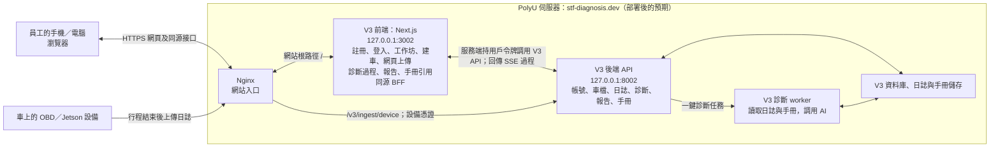

# STF V3 前端

Next.js 15 工作坊前端，提供 V3 邀請碼註冊與登入、工作坊建車、網頁上傳行車日誌、設備憑證管理，以及一鍵診斷、過程直播和報告。手機與電腦使用同一個響應式網頁。前端代碼尚未在 PolyU 上線；2026-11-03 已經由本機前端與 SSH 隧道驗證伺服器 V3 的測試車隊註冊、登入、工作坊讀取及登出。真實 Jetson 行程與弱網實機仍待驗收。

## 運行邊界

- 瀏覽器只連同源 Next.js 頁面與 `/api/auth/*`、`/api/portal/*`；不連 `127.0.0.1`、V3 API 或資料庫。Next.js BFF 使用服務端的 `STF_V3_API_BASE_URL` 連 V3 API。
- BFF 使用 V3 邀請註冊、登入、工作坊/車檔、車輛日誌上傳、設備憑證、診斷歷史、`POST /v3/vehicles/{id}/diagnose`、會話詳情、JSON 事件回放、SSE 直播、報告，以及手冊章節/圖片接口。JWT 只存在 HttpOnly、SameSite=Strict Cookie；每次受保護請求以 `/v3/users/me` 驗證身份。JSON 業務資料按白名單映射，SSE 事件按 V3 協議流式轉發，私有回應不緩存。寫入接口檢查 Origin，設備憑證僅顯示一次。
- `/register` 使用邀請碼註冊；`/` 顯示工作坊；`/workshops/{id}` 可搜尋、分頁及建車；`/vehicles/{id}` 顯示車檔、日誌、診斷歷史、手動上傳及 manager 設備憑證。上傳只存日誌；每筆日誌另有「一鍵診斷」。會話頁從伺服器回放事件，再接續直播，重新整理可恢復過程。報告顯示正文、局限及引用；只有經工具軌跡核實的手冊引用可打開 V3 入庫後轉換的 Markdown 原文章節與圖片，`NO_SOURCE` 僅標示未核實而不提供原文連結。手冊頁可切換排版閱讀和原始 Markdown，並非原 PDF 頁面。舊車牌/VIN 深鏈只回工作坊入口，不自行配對 V3 車檔。
- 登入時僅去除用戶名稱首尾空格，密碼原樣送出；錯誤憑據、來源不符、限流和服務故障分別提示。已有登入 Cookie 但 V3 暫時無法核對身份時，登入頁提示重試，不清除 Cookie。
- Service Worker 只快取靜態資源和離線提示，`/api/auth/*`、`/api/portal/*` 永遠從網絡取資料；離線時不展示先前的車檔、日誌、診斷或報告。

## 部署後的使用形態與尚存差距

以下是 **本地 fork 代碼部署到 PolyU 後的預期形態**，不是目前網站已完成切換的聲明。對照基準為 2026-11-03 核查的 [issue #270](https://github.com/qmohsu/stf_ai_diagnosis_platform_v1/issues/270)、canonical `main` `79af214` 的 [V3 開發計劃](https://github.com/qmohsu/stf_ai_diagnosis_platform_v1/blob/79af214fc37de81560c794b88c983fecc7cc480c/docs/v3_dev_plan.md)及本倉庫代碼。



瀏覽器不直連 `:8002`；網頁上傳先到前端 BFF，車載設備上傳則經 Nginx 直接到 V3 後端。收到日誌只入庫，診斷仍由員工點擊「一鍵診斷」觸發。車端同時向舊系統上傳的獨立路徑不屬於本 V3 圖，要求見 [issue #257](https://github.com/qmohsu/stf_ai_diagnosis_platform_v1/issues/257)。

下表區分 **已有代碼** 和 **尚待合入、部署或實地驗收**；不能把本地模擬測試寫成 PolyU 驗收通過。

| 尚存差距 | 目前事實 | 消除差距的位置與工作 |
| --- | --- | --- |
| 1. 尚未進入 canonical `main` | canonical `79af214` 沒有 `obd-ui-v3/`；其 V3 OpenAPI 也沒有 fork 新增的手冊章節和圖片讀取路徑。只部署 canonical `main` 無法得到圖中的完整鏈路；兩邊提交已分叉，見 [issue #275](https://github.com/qmohsu/stf_ai_diagnosis_platform_v1/issues/275)。 | 將 `obd-ui-v3/`、相關 `infra/` 設定、`stf_v3/` 手冊只讀接口、`docs/api/` 契約、`.github/workflows/` 檢查及 `docs/` 文圖一併帶入待審 PR；處理衝突並核對代碼與文檔。 |
| 2. 伺服器入口與真實後端尚未完成驗收 | fork 已配置 Nginx 根路徑、前端 `:3002` 及 V3 `:8002`；2026-11-03 專用測試車隊的註冊、登入與工作坊讀取經 SSH 隧道通過。當日只讀核查：PolyU V3 為 `073c112`，API/worker 在運行、Nginx 停止，新增手冊章節/圖片路由尚未部署；真實上傳、SSE 與手冊卷仍未驗收。 | 按 [V3 運維手冊](../docs/v3_ops_runbook.md)記錄原版本，從 fork 取得並核對已審核的完整提交哈希，檢查 Compose、Origin、`:3002` 健康與鏡像 revision，然後由管理者切換入口。公開 HTTPS 手機/電腦流程及回滾另行驗收；本機測試不能代替。 |
| 3. 車載設備尚未實車自動上傳 | [上傳器](../obd_agent/jetson_uploader.py)和 `/v3/ingest/device` 已有代碼，網頁可向 manager 提供一次性憑證；實際設備行程、斷網補傳和重啟後補傳尚未驗收。 | 按 [issue #257](https://github.com/qmohsu/stf_ai_diagnosis_platform_v1/issues/257)在**車上設備**配置每車憑證、上傳觸發與定時補傳，完成自檢和真實行程；在 `docs/v3_device_install.md` 記錄脫敏結果。只有發現缺陷才改 `obd_agent/` 或 `stf_v3/`；真實 VIN、令牌和邀請碼不進 Git 倉庫。 |
| 4. 首批真實用戶閉環尚未完成 | 專用測試車隊的一次性邀請碼註冊與登入已通過；建車、上傳、診斷、報告仍只在模擬 V3 下測試。PROD-12、PROD-13、PROD-15B 仍要求真實 pilot 用戶、日誌與手機診斷。 | 在伺服器與運維流程中發放真實邀請碼、配置第二位 manager、劃定測試與真實工作坊邊界，讓 pilot 用戶在手機上完成一次真實診斷；發現問題再修 `obd-ui-v3/`、`stf_v3/` 或 `infra/`，並更新 `docs/v3_dev_plan.md` 的驗收狀態。 |
| 5. 手機安裝與真實弱網未驗收 | 已有 [manifest](src/app/manifest.ts)、`public/` 圖標、靜態離線殼和 [上傳進度／取消／重試](src/components/log-upload.tsx)；模擬慢請求不等於真機弱網。 | 在 `obd-ui-v3/src/app/`、`obd-ui-v3/public/`、`obd-ui-v3/tests/e2e/` 修復實測兼容問題；按 PROD-14 驗證 Android Chrome、iOS Safari 安裝、Lighthouse PWA、離線私有資料不回顯及弱網上傳。 |
| 6. 最終報告雙視圖未定、未實現 | [診斷頁](src/components/conversation-view.tsx)有**過程**的「簡明進度／技術細節」切換；報告本身仍是一個 Markdown 視圖，不能用過程雙視圖代替 PROD-13 驗收。 | 先與維護者確定報告兩種視圖的內容，再改 `obd-ui-v3/src/components/` 及測試；只有現有報告資料不足時才改 `stf_v3/diagnosis/`、`docs/api/`，並同步 V3 文檔。 |
| 7. 引用品質需要真實手冊核對 | fork 可開啟入庫後的**轉換版 Markdown 章節和圖片**，不是原始 PDF 頁；前端已限制只有 `trace` 手冊引用可點，`NO_SOURCE` 標為未核實且不提供連結。同名章節的唯一定位由本地 V3 接口驗證。模擬手冊仍不能證明真實卷的結論準確；PolyU 運行版和 canonical 尚未包含新增讀取接口。 | 合入 `stf_v3/knowledge/`、`obd-ui-v3/` 和 `docs/api/` 後，按 [V3 運維手冊](../docs/v3_ops_runbook.md)用真實手冊卷核對報告結論、章節原串、原文段落、圖片、同名章節及 `NO_SOURCE`；若結論缺證據，再修 `stf_v3/diagnosis/` 的生成與評測。 |

以上是 issue #270 的 Stage 1 與部署差距。車隊病歷與 Dashboard、報告追問、自由對話、上傳後自動診斷、相似案例和車端視覺 AI 屬後續階段或研究事項，不應為了關閉本表而提前加入。

## 本地開發與驗證

需要 Node.js 24、npm 11 和可用的 V3 API。從本目錄執行：

```powershell
Copy-Item .env.example .env.local
npm ci
npm run dev
```

開啟 `http://127.0.0.1:3001`。本地 `OBD Expert.cmd` 仍可作為開發輔助啟動 V3 API 和前端；正式使用者只訪問 PolyU 服務器網站。

| 變數 | 用途 |
| --- | --- |
| `STF_V3_API_BASE_URL` | 只供 Next.js 服務端訪問的 V3 API；本地示例 `http://127.0.0.1:8002` |
| `PORTAL_PUBLIC_ORIGIN` | 公開網頁 Origin；生產值為 `https://stf-diagnosis.dev`，用於登入/登出的同源檢查 |
| `PORT` | 本地預設 3001；PolyU V3 Compose 設為 3002 |

```powershell
npm run typecheck
npm run lint
npm run test
npm run test:contract
npm run build
npx playwright install chromium
npm run test:e2e
```

E2E 使用本地模擬 V3 API，覆蓋手機/桌面的註冊、建車、上傳、設備憑證、日誌診斷、過程刷新恢復、報告與引用，無需真實帳號或連外網。`docs/api/v3_openapi.json` 是本倉庫凍結的接口契約。本地測試不能替代 PolyU 上的 V3 API、共用 GPU、真實設備與公開網站驗收。

## PolyU 部署

正式服務由 `infra/docker-compose.v3.yml` 加 `infra/docker-compose.v3.polyu.yml` 啟動 `stf-v3-frontend`。容器以 host network 只監聽 `127.0.0.1:3002`，Nginx 將 `https://stf-diagnosis.dev/` 轉發到前端；`/v3/` 仍轉發到現有 V3 API。前端映像的 OCI revision label 記錄構建提交。部署、健康檢查、分支驗收與回滾步驟見 `docs/v3_ops_runbook.md`。正式運行不需要 `vehicle_data_twin` 或任何員工電腦上的本地服務。
