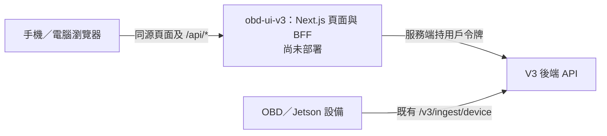

# STF V3 前端

Next.js 15 工作坊前端，提供邀請碼註冊與登入、工作坊建車、網頁上傳行車日誌、設備憑證、一鍵診斷、過程直播與回放、報告和手冊引用。手機與電腦使用同一個響應式網頁。[後端手冊來源接口 PR #276](https://github.com/qmohsu/stf_ai_diagnosis_platform_v1/pull/276) 已合入原倉庫。本前端尚未在 PolyU 部署，也未切換網站首頁；Compose、Nginx、持久日誌卷與正式回滾配置屬後續上線 PR。

## 運行邊界

- 瀏覽器只連同源 Next.js 頁面與 `/api/auth/*`、`/api/portal/*`，不直連 V3 API 或資料庫。BFF 以服務端 `STF_V3_API_BASE_URL` 訪問 V3；JWT 只存 HttpOnly、SameSite=Strict Cookie，每次受保護請求以 `/v3/users/me` 驗證身份。寫入接口檢查 Origin；私有回應不緩存。
- `/register` 使用邀請碼註冊；`/` 顯示工作坊；工作坊頁提供車輛搜尋、分頁與建車；車輛頁提供車檔、日誌、手動上傳、診斷歷史與 manager 設備憑證。單份日誌最多 50 MB，上傳只入庫，不自動診斷。設備憑證明文僅在發放時顯示一次。
- 使用者對已有日誌點「一鍵診斷」；會話頁先取 JSON 事件回放，再以 SSE 接續直播，按序號續傳和去重。簡明進度與技術細節是**診斷過程**的兩種顯示；最終報告只有一種視圖。報告引用只在工具軌跡核實且可解析時連到已入庫手冊的轉換版 Markdown 章節及圖片；`NO_SOURCE` 不提供原文連結。手冊頁的原始 Markdown 不是原 PDF 頁面。
- JSON 業務資料按白名單映射；Service Worker 只快取靜態資源與離線提示，不離線回放登入、車輛、診斷或手冊私有資料。舊車牌/VIN 深鏈只回工作坊入口，不自行配對 V3 車檔。
- 所有 BFF API 回應帶請求 ID。JSON 訪問記錄同時寫標準輸出與文件，包含 UTC 時間、請求 ID、可取得的用戶與車輛 ID、固定路由名及狀態；不記錄正文、Cookie、令牌、VIN、原始 URL 或查詢串。文件按 UTC 日切、壓縮、保留 30 天；總量超過 2 GB 時先清理舊歸檔，不截斷當日記錄。容器內日誌目錄只供運行用戶寫入；生產持久卷由上線 PR 配置。

## 已有代碼與待驗收項



前端已在本地模擬 V3 下測試註冊、建車、上傳、設備憑證、診斷、報告與引用；2026-11-03 曾以專用測試車隊經本機前端及 SSH 隧道驗證伺服器 V3 的註冊、登入、工作坊讀取及登出。這些結果不代表前端已上線。仍需驗收真實 Jetson 行程與補傳、真實手冊卷引用、公開 HTTPS 完整診斷、Android/iOS 安裝、弱網上傳及 pilot 用戶。正式設備接入要求見 [issue #257](https://github.com/qmohsu/stf_ai_diagnosis_platform_v1/issues/257)。前端目前使用 Tailwind v4 與 Radix 組件，既定 shadcn/ui 選型尚未在頁面中實際採用，待維護者決定。

## 本地開發與驗證

需要 Node.js 24、npm 11 和可用的 V3 API。從本目錄執行：

```powershell
Copy-Item .env.example .env.local
npm ci
npm run dev
```

開啟 `http://127.0.0.1:3001`。Windows 本地聯調首次使用時，先安裝 Python 3.12 和 PostgreSQL 15，執行 `powershell.exe -NoProfile -ExecutionPolicy Bypass -File .\scripts\setup_local_windows.ps1`；腳本會要求輸入本機 PostgreSQL 管理員密碼，並把應用資料庫連線與 JWT 密鑰寫到用戶私有的 `%LOCALAPPDATA%\OBD Expert\stf_v3.env`。其後可用 `OBD Expert.cmd` 啟動本機 V3 API 和前端。這些腳本只供開發聯調。

| 變數 | 用途 |
| --- | --- |
| `STF_V3_API_BASE_URL` | Next.js 服務端使用的 V3 API；本地示例 `http://127.0.0.1:8002` |
| `PORTAL_PUBLIC_ORIGIN` | 網頁 Origin；本地示例 `http://127.0.0.1:3001`，正式值待上線 PR 配置 |
| `PORT` | 本地預設 3001；正式監聽設定待上線 PR |
| `PORTAL_ACCESS_LOG_DIR` | 可選；本地預設 `obd-ui-v3/.portal-logs/`，容器預設 `/var/log/stf-v3-frontend` |

```powershell
npm run verify
npm run test:contract
npx playwright install chromium
npm run test:e2e
```

E2E 使用本地模擬 V3 API，不需真實帳號。本地測試不能代替 PolyU 上的 V3 API、共用 GPU、實際設備與公開網站驗收。前端 CI 另檢查 Windows 啟動器並構建固定 Node 24 Alpine 摘要的容器映像；Compose、Nginx、網站切換及回滾由後續 PR 處理。
